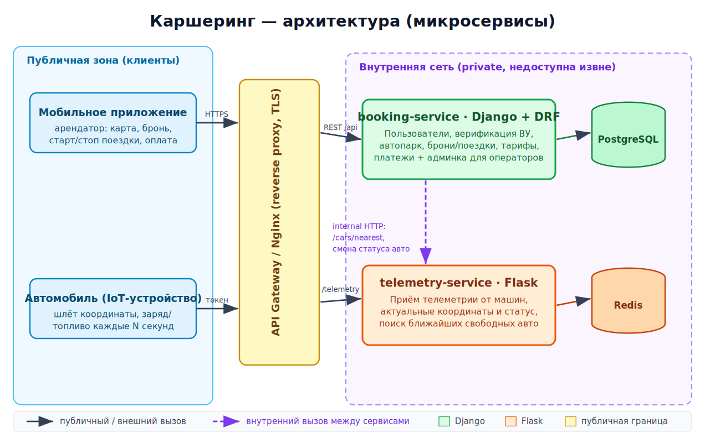
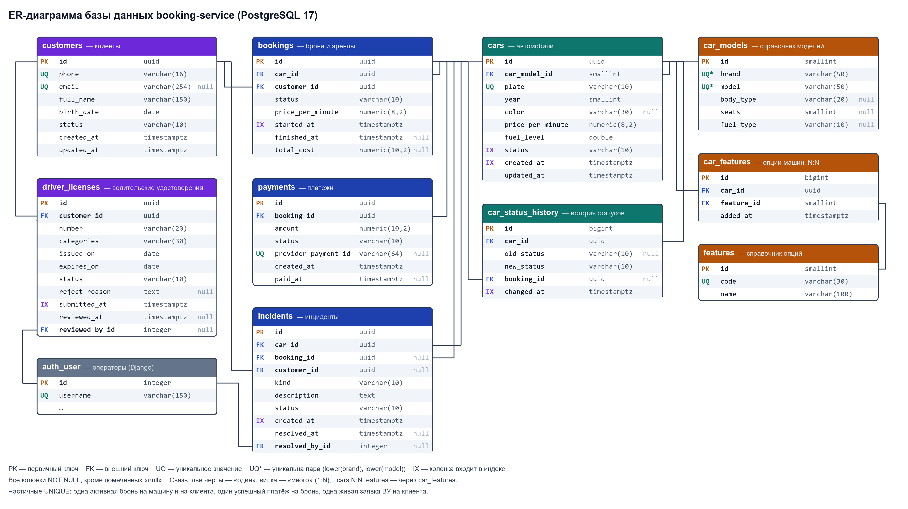

# Каршеринг — учебный проект (микросервисы)

Монорепозиторий проекта поминутной аренды автомобилей (каршеринг).
Разбит на два независимых микросервиса на разных фреймворках, чтобы каждый
решал свою задачу подходящим инструментом.

## Предметная сфера

Каршеринг — краткосрочная поминутная/почасовая аренда авто через приложение
без оператора: пользователь находит ближайшую свободную машину на карте,
бронирует, начинает поездку и платит только за фактическое время.
Полная бизнес-задача и пользовательские истории — в
[`docs/requirements.md`](docs/requirements.md).

## Архитектура



Редактируемый исходник схемы: [`docs/architecture.drawio`](docs/architecture.drawio)
(открывается в [draw.io](https://app.diagrams.net)).

- **Публичная граница** — API Gateway (reverse proxy, TLS). Наружу открыт
  только он.
- **`booking-service` (Django + DRF)** — ядро бизнес-домена: пользователи,
  верификация ВУ, автопарк, брони/поездки, тарифы, платежи. Публичный REST
  для мобильного клиента.
- **`telemetry-service` (Flask)** — приём координат от машин и поиск
  ближайших свободных авто в реальном времени.
- **Внутренний вызов**: `booking-service` спрашивает у `telemetry-service`
  ближайшие свободные машины и сообщает ему о смене статуса авто
  (забронирована / в аренде / свободна). Наружу `telemetry-service` не
  смотрит.

## Стек

| Сервис | Фреймворк | Хранилище | Зона ответственности | Почему такой выбор |
|---|---|---|---|---|
| `booking-service` | Django 6 + DRF | PostgreSQL | Пользователи, автопарк, брони, тарифы, платежи, админка | Сложная реляционная модель со связями, нужны встроенные аутентификация/права, миграции и готовая **админка** для операторов; DRF даёт быстрый REST-CRUD. Django берут, когда домена много и он «данными тяжёлый». |
| `telemetry-service` | Flask 3 | Redis (в скелете — in-memory) | Приём телеметрии, поиск ближайших свободных | 2–3 простых **высокочастотных** эндпоинта, важна низкая задержка и минимум оверхеда; админка/ORM не нужны. Flask берут для лёгких, узкоспециализированных сервисов, легко масштабируемых горизонтально. |

> Именно эта пара показывает разницу: **Django** — когда нужны данные,
> связи и админка; **Flask** — когда нужен маленький быстрый сервис с парой
> эндпоинтов.

## Структура репозитория

```
carsharing/
├── README.md
├── .gitignore
├── docs/
│   ├── requirements.md      # бизнес-задача, user stories, критерии приёмки
│   ├── api.md               # ПР2: сущность Car, URI, валидация, формат ошибок
│   ├── examples.http        # ПР2–ПР3: примеры запросов и ответов
│   ├── database.md          # ПР3: схема БД, индексы, миграции, транзакции
│   ├── er-diagram.png       # ПР3: ER-диаграмма (исходник — er-diagram.dbml)
│   ├── auth.md              # ПР4: пользователи, JWT, роли, единый формат ошибок
│   ├── auth-check.md        # ПР4: протокол проверки сценариев доступа
│   ├── backlog.md           # бэклог на семестр для Kanban
│   ├── architecture.drawio  # редактируемая схема
│   ├── architecture.svg
│   └── architecture.png
├── booking-service/         # Django + DRF (+ openapi.yaml — контракт API)
└── telemetry-service/       # Flask
```

## Как запустить

Нужен Python 3.12+. Каждый сервис запускается независимо.

### booking-service (Django, порт 8010)

```bash
cd booking-service
python -m venv .venv && source .venv/bin/activate   # Windows: .venv\Scripts\activate
pip install -r requirements.txt
cp .env.example .env        # параметры подключения к PostgreSQL
python manage.py migrate
python manage.py runserver 8010
```
Проверка: `curl http://127.0.0.1:8010/health`
→ `{"status":"ok","service":"booking-service","framework":"django", ...}`

### telemetry-service (Flask, порт 8020)

```bash
cd telemetry-service
python -m venv .venv && source .venv/bin/activate
pip install -r requirements.txt
python app.py
```
Проверка: `curl http://127.0.0.1:8020/health`
→ `{"status":"ok","service":"telemetry-service","framework":"flask", ...}`

Быстрый прогон телеметрии:
```bash
curl -X POST http://127.0.0.1:8020/telemetry \
  -H 'Content-Type: application/json' \
  -d '{"car_id":"A-101","lat":55.7512,"lon":37.6175,"status":"free","fuel":0.8}'

curl "http://127.0.0.1:8020/cars/nearest?lat=55.7515&lon=37.6170&radius_km=3"
```

## Управление задачами

Бэклог на семестр — в [`docs/backlog.md`](docs/backlog.md); он перенесён на
Kanban-доску (колонки Backlog → To Do → In Progress → Review → Done).

## REST API (ПР2)

Основная сущность предметной области — автомобиль автопарка (`Car`), ресурс
`/api/v1/cars` в `booking-service`. Контракт описан формально в
[`booking-service/openapi.yaml`](booking-service/openapi.yaml) (OpenAPI 3.0.3),
проектные решения — в [`docs/api.md`](docs/api.md), примеры запросов и
ответов — в [`docs/examples.http`](docs/examples.http).

| Метод | Путь | Назначение |
|---|---|---|
| GET | /api/v1/cars | Список с пагинацией (`page`, `limit`) и фильтрами (`status`, `brand`, `max_price_per_minute`) |
| POST | /api/v1/cars | Добавить машину |
| GET | /api/v1/cars/{id} | Получить машину |
| PUT | /api/v1/cars/{id} | Полностью заменить данные |
| PATCH | /api/v1/cars/{id} | Частично обновить |
| DELETE | /api/v1/cars/{id} | Убрать из автопарка |

Все ошибки — в едином формате `{"error": {"code": "...", "message": "...", "details": [...]}}`.

## База данных (ПР3)

`booking-service` хранит данные в PostgreSQL: 10 таблиц ядра — клиенты и их
водительские удостоверения, справочник моделей, автомобили и их опции (N:N),
брони, платежи, журнал статусов машин и инциденты. Схема создаётся миграциями
Django, параметры подключения — только из переменных окружения ([`booking-service/.env.example`](booking-service/.env.example)).
ER-диаграмма, ограничения, индексы и транзакционные сценарии — в
[`docs/database.md`](docs/database.md).



## Аутентификация и авторизация (ПР4)

Пользователи API хранятся в таблице `users` (email, хэш пароля Argon2id,
роль, дата регистрации). Регистрация — `POST /api/v1/auth/register`, вход —
`POST /api/v1/auth/login`; в ответ на вход сервис выдаёт **JWT access-токен**,
который клиент передаёт в каждом запросе: `Authorization: Bearer <token>`.

Роли: `customer` (клиент — только свои профиль, ВУ и брони), `operator`
(проверка ВУ, блокировка клиентов, статусы машин, все брони) и `admin`
(вдобавок добавление и удаление машин, управление ролями). Без токена
защищённый маршрут отвечает 401, с токеном, но без нужной роли или к чужой
записи — 403. Все ошибки API, включая 500, — в едином формате
`{"error": {"code", "message", "details"}}`.

**Почему JWT, а не серверная сессия.** Основной клиент — мобильное
приложение, а не браузер: токен в заголовке удобнее cookie и не требует
защиты от CSRF. Проверка JWT — это проверка подписи и срока без обращения к
общему хранилищу сессий, поэтому экземпляры `booking-service` масштабируются
горизонтально, а тот же токен в будущем сможет проверять API Gateway или
`telemetry-service`. Главный минус JWT — токен нельзя отозвать до истечения —
закрыт коротким сроком жизни (60 минут) и тем, что пользователь при каждом
запросе читается из базы: блокировка и смена роли действуют сразу.

Подробности — в [`docs/auth.md`](docs/auth.md), протокол проверки трёх
сценариев доступа на реальных запросах — в [`docs/auth-check.md`](docs/auth-check.md).
