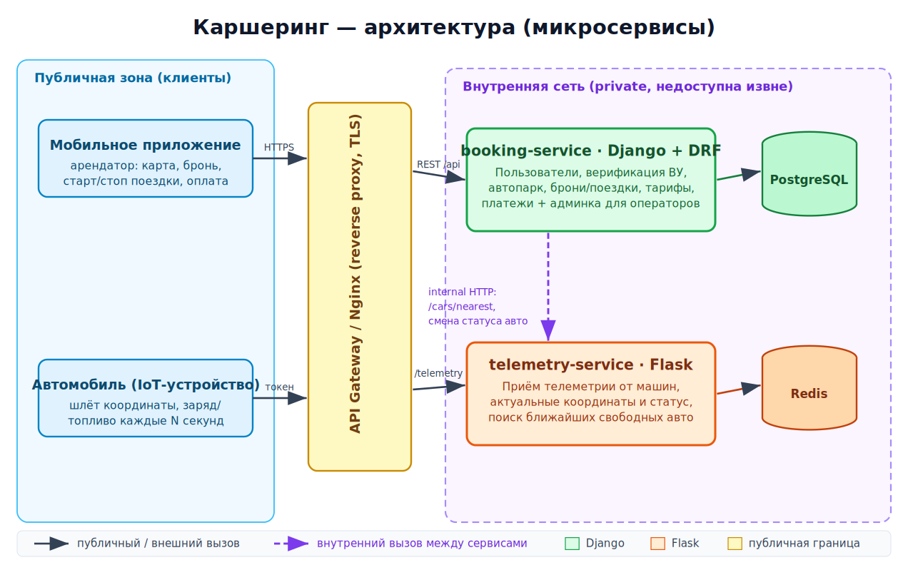
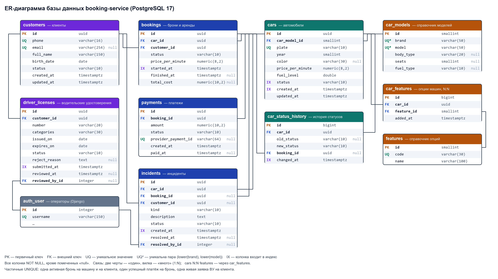

# Каршеринг — учебный проект (микросервисы)

[](https://github.com/Zxcloxg/carsharing/actions/workflows/ci.yml)

Монорепозиторий проекта поминутной аренды автомобилей (каршеринг).
Разбит на два независимых микросервиса на разных фреймворках, чтобы каждый
решал свою задачу подходящим инструментом.

## Предметная сфера

Каршеринг — краткосрочная поминутная/почасовая аренда авто через приложение
без оператора: пользователь находит ближайшую свободную машину на карте,
бронирует, начинает поездку и платит только за фактическое время.
Полная бизнес-задача и пользовательские истории — в
[`docs/requirements.md`](docs/requirements.md).

## Архитектура



Редактируемый исходник схемы: [`docs/architecture.drawio`](docs/architecture.drawio)
(открывается в [draw.io](https://app.diagrams.net)).

- **Публичная граница** — API Gateway (reverse proxy, TLS). Наружу открыт
  только он.
- **`booking-service` (Django + DRF)** — ядро бизнес-домена: пользователи,
  верификация ВУ, автопарк, брони/поездки, тарифы, платежи. Публичный REST
  для мобильного клиента.
- **`telemetry-service` (Flask)** — приём координат от машин и поиск
  ближайших свободных авто в реальном времени.
- **Внутренний вызов**: `booking-service` спрашивает у `telemetry-service`
  ближайшие свободные машины и сообщает ему о смене статуса авто
  (забронирована / в аренде / свободна). Наружу `telemetry-service` не
  смотрит.

## Стек

| Сервис | Фреймворк | Хранилище | Зона ответственности | Почему такой выбор |
|---|---|---|---|---|
| `booking-service` | Django 6 + DRF | PostgreSQL | Пользователи, автопарк, брони, тарифы, платежи, админка | Сложная реляционная модель со связями, нужны встроенные аутентификация/права, миграции и готовая **админка** для операторов; DRF даёт быстрый REST-CRUD. Django берут, когда домена много и он «данными тяжёлый». |
| `telemetry-service` | Flask 3 | Redis (в скелете — in-memory) | Приём телеметрии, поиск ближайших свободных | 2–3 простых **высокочастотных** эндпоинта, важна низкая задержка и минимум оверхеда; админка/ORM не нужны. Flask берут для лёгких, узкоспециализированных сервисов, легко масштабируемых горизонтально. |

> Именно эта пара показывает разницу: **Django** — когда нужны данные,
> связи и админка; **Flask** — когда нужен маленький быстрый сервис с парой
> эндпоинтов.

## Структура репозитория

```
carsharing/
├── README.md
├── .gitignore
├── docker-compose.yml       # ПР7: вся система одной командой
├── .env.example             # ПР7: переменные для docker compose (без значений)
├── deploy_check.py          # ПР7: финальная проверка в контейнерах -> docs/deploy-check.md
├── .github/workflows/ci.yml # ПР7: CI — линтер, тесты, сборка образов, запуск системы
├── docs/
│   ├── requirements.md      # бизнес-задача, user stories, критерии приёмки
│   ├── api.md               # ПР2: сущность Car, URI, валидация, формат ошибок
│   ├── examples.http        # ПР2–ПР3: примеры запросов и ответов
│   ├── database.md          # ПР3: схема БД, индексы, миграции, транзакции
│   ├── er-diagram.png       # ПР3: ER-диаграмма (исходник — er-diagram.dbml)
│   ├── auth.md              # ПР4: пользователи, JWT, роли, единый формат ошибок
│   ├── auth-check.md        # ПР4: протокол проверки сценариев доступа
│   ├── testing.md           # ПР5: автотесты, изоляция, покрытие
│   ├── security.md          # ПР5: чек-лист OWASP API, найденные и исправленные проблемы
│   ├── security-check*.md   # ПР5: протоколы проверки безопасности до и после исправлений
│   ├── background-tasks.md  # ПР6: фоновое списание — выбор, устройство, повторы, логи
│   ├── async-scenario.md    # ПР6: протокол проверки штатного и ошибочного пути
│   ├── deployment.md        # ПР7: Docker, compose, секреты, health, логи и метрики, CI
│   ├── deploy-check.md      # ПР7: протокол проверки системы «с нуля» в контейнерах
│   ├── backlog.md           # бэклог на семестр для Kanban
│   ├── architecture.drawio  # редактируемая схема
│   ├── architecture.svg
│   └── architecture.png
├── booking-service/         # Django + DRF (+ openapi.yaml — контракт API)
└── telemetry-service/       # Flask
```

## Как запустить

### Вся система в Docker (ПР7) — рекомендуемый способ

```bash
cp .env.example .env                   # заполнить DB_PASSWORD, DJANGO_SECRET_KEY, JWT_SECRET
docker compose up -d --build --wait    # база, миграции, API, обработчик задач, эмулятор провайдера, телеметрия
curl http://localhost:8010/health      # {"status": "ok", "checks": {"database": {"status": "ok", ...}, ...}}
```

Миграции применяются автоматически (сервис `migrate`), данные базы хранятся в томе `pgdata`,
логи — JSON в `docker compose logs`, метрики — `GET /metrics`. Подробно — в
[`docs/deployment.md`](docs/deployment.md).

### Без Docker

Нужен Python 3.12+. Каждый сервис запускается независимо.
Фоновые задачи `booking-service` выполняет отдельный процесс-обработчик (ПР6, см. ниже).

#### booking-service (Django, порт 8010)

```bash
cd booking-service
python -m venv .venv && source .venv/bin/activate   # Windows: .venv\Scripts\activate
pip install -r requirements.txt
cp .env.example .env        # параметры подключения к PostgreSQL
python manage.py migrate
python manage.py runserver 8010
python manage.py run_worker                  # во втором окне: обработчик фоновых задач (ПР6)
python payment_provider_stub.py              # в третьем: эмулятор платёжного провайдера, порт 8030
```
Проверка: `curl http://127.0.0.1:8010/health`
→ `{"status":"ok","service":"booking-service","framework":"django", ...}`

#### telemetry-service (Flask, порт 8020)

```bash
cd telemetry-service
python -m venv .venv && source .venv/bin/activate
pip install -r requirements.txt
python app.py
```
Проверка: `curl http://127.0.0.1:8020/health`
→ `{"status":"ok","service":"telemetry-service","framework":"flask", ...}`

Быстрый прогон телеметрии:
```bash
curl -X POST http://127.0.0.1:8020/telemetry \
  -H 'Content-Type: application/json' \
  -d '{"car_id":"A-101","lat":55.7512,"lon":37.6175,"status":"free","fuel":0.8}'

curl "http://127.0.0.1:8020/cars/nearest?lat=55.7515&lon=37.6170&radius_km=3"
```

## Управление задачами

Бэклог на семестр — в [`docs/backlog.md`](docs/backlog.md); он перенесён на
Kanban-доску (колонки Backlog → To Do → In Progress → Review → Done).

## REST API (ПР2)

Основная сущность предметной области — автомобиль автопарка (`Car`), ресурс
`/api/v1/cars` в `booking-service`. Контракт описан формально в
[`booking-service/openapi.yaml`](booking-service/openapi.yaml) (OpenAPI 3.0.3),
проектные решения — в [`docs/api.md`](docs/api.md), примеры запросов и
ответов — в [`docs/examples.http`](docs/examples.http).

| Метод | Путь | Назначение |
|---|---|---|
| GET | /api/v1/cars | Список с пагинацией (`page`, `limit`) и фильтрами (`status`, `brand`, `max_price_per_minute`) |
| POST | /api/v1/cars | Добавить машину |
| GET | /api/v1/cars/{id} | Получить машину |
| PUT | /api/v1/cars/{id} | Полностью заменить данные |
| PATCH | /api/v1/cars/{id} | Частично обновить |
| DELETE | /api/v1/cars/{id} | Убрать из автопарка |

Все ошибки — в едином формате `{"error": {"code": "...", "message": "...", "details": [...]}}`.

## База данных (ПР3)

`booking-service` хранит данные в PostgreSQL: 10 таблиц ядра — клиенты и их
водительские удостоверения, справочник моделей, автомобили и их опции (N:N),
брони, платежи, журнал статусов машин и инциденты. Схема создаётся миграциями
Django, параметры подключения — только из переменных окружения ([`booking-service/.env.example`](booking-service/.env.example)).
ER-диаграмма, ограничения, индексы и транзакционные сценарии — в
[`docs/database.md`](docs/database.md).



## Аутентификация и авторизация (ПР4)

Пользователи API хранятся в таблице `users` (email, хэш пароля Argon2id,
роль, дата регистрации). Регистрация — `POST /api/v1/auth/register`, вход —
`POST /api/v1/auth/login`; в ответ на вход сервис выдаёт **JWT access-токен**,
который клиент передаёт в каждом запросе: `Authorization: Bearer <token>`.

Роли: `customer` (клиент — только свои профиль, ВУ и брони), `operator`
(проверка ВУ, блокировка клиентов, статусы машин, все брони) и `admin`
(вдобавок добавление и удаление машин, управление ролями). Без токена
защищённый маршрут отвечает 401, с токеном, но без нужной роли или к чужой
записи — 403. Все ошибки API, включая 500, — в едином формате
`{"error": {"code", "message", "details"}}`.

**Почему JWT, а не серверная сессия.** Основной клиент — мобильное
приложение, а не браузер: токен в заголовке удобнее cookie и не требует
защиты от CSRF. Проверка JWT — это проверка подписи и срока без обращения к
общему хранилищу сессий, поэтому экземпляры `booking-service` масштабируются
горизонтально, а тот же токен в будущем сможет проверять API Gateway или
`telemetry-service`. Главный минус JWT — токен нельзя отозвать до истечения —
закрыт коротким сроком жизни (60 минут) и тем, что пользователь при каждом
запросе читается из базы: блокировка и смена роли действуют сразу.

Подробности — в [`docs/auth.md`](docs/auth.md), протокол проверки трёх
сценариев доступа на реальных запросах — в [`docs/auth-check.md`](docs/auth-check.md).

## Тестирование (ПР5)

Автотесты `booking-service` лежат в [`booking-service/tests/`](booking-service/tests):
109 модульных (бизнес-правила, валидация, токены и права, политика повторов — без базы и
сети), 198 API- и интеграционных (эндпоинты через тестовый клиент, позитивные и негативные
сценарии, очередь задач, вызов платёжного провайдера, health-check и метрики) и 45 тестов
безопасности (числа — после ПР7). Каждый тест работает в транзакции, которая откатывается, на отдельной
базе `test_<DB_NAME>`; тесты проходят в любом порядке (`--shuffle`).

```bash
cd booking-service
pip install -r requirements.txt -r requirements-dev.txt
python manage.py test tests                                    # 352 теста (Windows: test.cmd)
python -m coverage run manage.py test tests && python -m coverage report   # Windows: coverage.cmd
python -m coverage html                                        # отчёт: booking-service/htmlcov/index.html
```

**Покрытие — 97,8 %** (строки 98,4 %, ветвления 93,7 %; в ПР5 было 97,9 %). Доступ, маршруты, схемы и команды
покрыты полностью. Слабее всего покрыты действия админки Django (88,6 %), которые проверялись
вручную, и защитные ветки на случай гонок, до которых не дойти через API. Подробности — в
[`docs/testing.md`](docs/testing.md).

Проверка по OWASP API Security Top 10 нашла и устранила четыре проблемы: обход лимита
попыток входа подменой `X-Forwarded-For`, ошибку 500 при входе с токеном, право оператора
менять тариф машины и включённый режим отладки с ключом в репозитории. Чек-лист и записи
«до/после» — в [`docs/security.md`](docs/security.md).

## Фоновые задачи (ПР6)

**Выбран вариант А — фоновая задача: списание денег за поездку.** Клиент завершает поездку,
стоя у машины, и ответ должен прийти сразу: машина освобождается для следующего клиента, а
поминутная оплата останавливается. Банк-эквайер отвечает за 1–3 секунды и иногда не отвечает
совсем. Пока списание шло внутри запроса, медленный банк задерживал завершение поездки, а
недоступный не давал её закрыть. Поэтому вызов провайдера вынесен в фон: поездка
закрывается всегда, а списание выполняется отдельно, с повторами и понятным статусом.

Как устроено:

- задачи объявлены встроенным в Django 6 API `django.tasks` (`@task`, `enqueue()`, статусы
  `READY / RUNNING / SUCCESSFUL / FAILED`) — [`fleet/tasks.py`](booking-service/fleet/tasks.py);
- очередь — таблица `background_tasks` в той же PostgreSQL. Свой бэкенд
  [`jobs/backends.py`](booking-service/jobs/backends.py) ставит задачу `INSERT`-ом в транзакции
  завершения поездки: не бывает ни платежа без задачи, ни задачи без платежа. Брокер вроде
  Redis или RabbitMQ не нужен;
- выполняет задачи отдельный процесс `python manage.py run_worker` (`worker.cmd`). Он
  выбирает задачи через `FOR UPDATE SKIP LOCKED`, поэтому обработчиков можно запустить несколько;
- `PATCH /api/v1/bookings/{id}` отвечает сразу (около 0,25 с вместо 1,5 с и больше), платёж в
  ответе — `pending`. Статус — `GET /api/v1/payments/{id}`, очередь для персонала —
  `GET /api/v1/tasks`;
- сбой провайдера (нет связи, тайм-аут 5 с, 5xx) ведёт к повтору через 2 с, затем через 4 с.
  Причина каждой попытки пишется в лог (WARNING) и в задачу. После 3 попыток задача
  получает `FAILED`, платёж — `failed` с причиной (ERROR в логе). Отказ банка (402)
  повторами не мучается. Клиент повторяет оплату через `POST /api/v1/bookings/{id}/payments`
  и получает **202 Accepted**. Повторы идут с ключом идемпотентности, поэтому двойного
  списания нет.

Локально провайдера заменяет эмулятор [`payment_provider_stub.py`](booking-service/payment_provider_stub.py)
(ключи `--latency`, `--fail-first N`, `--decline-over`). `async_check.cmd` запускает API,
обработчик и эмулятор, проходит штатный путь, путь с выключенным провайдером и
восстановление, а затем пишет протокол [`docs/async-scenario.md`](docs/async-scenario.md).
Устройство, обоснование механизма и ручная проверка описаны в
[`docs/background-tasks.md`](docs/background-tasks.md).

## Контейнеризация, развёртывание и наблюдаемость (ПР7)

- **Образы.** `booking-service/Dockerfile` и `telemetry-service/Dockerfile` построены на
  `python:3.12-slim`. Зависимости ставятся отдельным кэшируемым слоем, процесс работает не от
  root, API запускает production-сервер gunicorn. Один образ booking-service выполняет четыре
  роли: `api`, `worker`, `migrate`, `provider`.
- **docker-compose.yml.** PostgreSQL с именованным томом, одноразовый шаг миграций, API,
  обработчик фоновых задач, эмулятор провайдера и телеметрия. Сервисы находятся в одной сети и
  обращаются друг к другу по имени. Порядок старта: база healthy → миграции завершились → API и
  worker.
- **Секреты.** Значения задаются только в `.env` (файл в `.gitignore`); в compose-файле есть
  лишь ссылки `${VAR:?…}`. В CI секреты генерируются случайно.
- **Проверка состояния.** `/health` проверяет базу (`SELECT 1`) и очередь и отвечает 503, если
  база недоступна. По нему docker compose помечает контейнер healthy или unhealthy. Отдельно
  есть `/health/live` — только процесс.
- **Наблюдаемость.** JSON-логи с `request_id`: заголовок `X-Request-ID` возвращается в ответе.
  Каждый запрос оставляет строку с маршрутом, кодом и длительностью, а задачи очереди — строки
  с `task_id`. `GET /metrics` отдаёт метрики в формате Prometheus: запросы по маршрутам и кодам,
  гистограмму времени ответа, очередь задач, платежи и доступность базы.
- **CI.** [`.github/workflows/ci.yml`](.github/workflows/ci.yml) запускается на каждый push: линтер
  `ruff`, проверка миграций, 352 теста с покрытием не ниже 95 % на временной PostgreSQL, затем
  сборка образов, `docker compose up --wait` и проверка `/health`, входа и каталога. Статус —
  бейдж в начале README.

Финальная проверка «с нуля» в контейнерах (`python deploy_check.py`) повторяет сценарии ПР2–ПР6.
Протокол — [`docs/deploy-check.md`](docs/deploy-check.md), подробности — в
[`docs/deployment.md`](docs/deployment.md).
