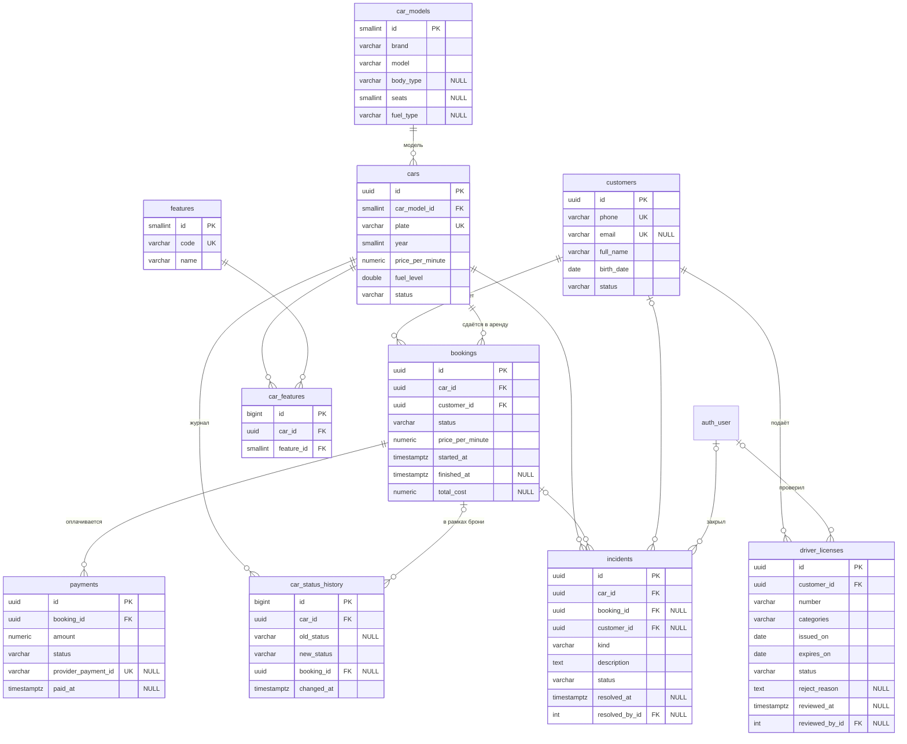

# База данных booking-service (ПР3)

СУБД — **PostgreSQL 17**, доступ через Django ORM (драйвер `psycopg` 3).
Схема описана моделями [`fleet/models.py`](../booking-service/fleet/models.py)
и создаётся только миграциями из
[`fleet/migrations/`](../booking-service/fleet/migrations/).

База покрывает весь домен ядра каршеринга из [`requirements.md`](requirements.md):
клиенты и верификация ВУ (US-4), автопарк (US-1, US-5), брони и аренды
(US-2, US-3), платежи (US-3), журнал статусов и инциденты для оператора (US-5).
Телеметрия (координаты машин, US-6) живёт в отдельном telemetry-service и в эту
базу не входит.

## 1. ER-диаграмма


Исходник в формате dbdiagram.io: [`er-diagram.dbml`](er-diagram.dbml).



## 2. Таблицы

10 таблиц проекта плюс служебные таблицы Django (`auth_user` — операторы админки,
`django_migrations` и др.). Все колонки `NOT NULL`, если не сказано иное.

| Таблица | Что хранит | Связи |
|---|---|---|
| `customers` | Клиенты: телефон (логин), email, ФИО, дата рождения, статус `active`/`blocked` | 1:N `driver_licenses`, `bookings`, `incidents` |
| `driver_licenses` | Заявки на проверку ВУ: номер, категории, срок действия, решение оператора | N:1 `customers`, N:1 `auth_user` (кто проверил) |
| `car_models` | Справочник моделей: марка, модель, кузов, мест, тип топлива | 1:N `cars` |
| `cars` | Автомобили: госномер, год, цвет, тариф, топливо, статус | N:1 `car_models`; 1:N `bookings`, `car_status_history`, `incidents`; N:N `features` |
| `features` | Справочник опций: детское кресло, полный привод, зимняя резина… | N:N `cars` через `car_features` |
| `car_features` | Связующая таблица «машина — опция» | N:1 `cars`, N:1 `features` |
| `bookings` | Аренды: машина, клиент, тариф на момент брони, время, стоимость | N:1 `cars`, N:1 `customers`; 1:N `payments` |
| `payments` | Списания за аренду, включая неуспешные попытки | N:1 `bookings` |
| `car_status_history` | Журнал смены статусов машины: когда, с какого на какой, в рамках какой брони | N:1 `cars`, N:1 `bookings` (необязательна) |
| `incidents` | Инциденты: повреждение, ДТП, грязный салон; кто и когда закрыл | N:1 `cars`; необязательные N:1 `bookings`, `customers`, `auth_user` |

### Почему таблицы разделены именно так

- **Клиент отдельно от брони.** `bookings.customer_id` ссылается на `customers`,
  а не хранит телефон строкой: данные клиента не дублируются в каждой брони, а правило «арендовать может только клиент с подтверждённым ВУ»
  проверяется по связанной таблице.
- **ВУ отдельно от клиента (1:N).** Заявку могут отклонить, и клиент подаёт новую —
  история проверок сохраняется. Частичный UNIQUE не даёт держать две «живые» заявки.
- **Справочник моделей (3НФ).** Марка/модель и характеристики модели (кузов, места,
  топливо) зависят от модели, а не от конкретной машины, поэтому вынесены в
  `car_models`. API машин при этом не изменился: `brand`/`model` по-прежнему
  передаются и отдаются строками, сервис сам находит или добавляет запись справочника.
- **Опции — связь N:N.** У машины несколько опций, одна опция у многих машин.
- **Платёж отдельно от брони (1:N).** Списание может не пройти и повториться;
  все попытки остаются в истории, успешная — не больше одной.
- **Журнал статусов** нужен оператору (US-5) и для разбора спорных ситуаций:
  статус в `cars` — только текущий, история — в `car_status_history`.
- **Тариф** хранится в `cars.price_per_minute` и копируется в `bookings` в момент
  брони: смена тарифа машины не меняет цену уже начатой аренды.

### `customers` — клиенты

| Колонка | Тип | Ограничения | Описание |
|---|---|---|---|
| `id` | uuid | PK | Генерирует приложение |
| `phone` | varchar(16) | UNIQUE, CHECK по регулярному выражению `^\+?[0-9]{10,15}$` | Логин клиента; по нему бронирует API |
| `email` | varchar(254) | NULL, UNIQUE | Необязателен; несколько NULL допустимы |
| `full_name` | varchar(150) | | ФИО |
| `birth_date` | date | CHECK `>= 1900-01-01` | Возраст ≥ 18 проверяет API (в CHECK нельзя использовать текущую дату) |
| `status` | varchar(10) | CHECK in (`active`, `blocked`) | Заблокированный клиент не может арендовать |
| `created_at`, `updated_at` | timestamptz | | |

### `driver_licenses` — водительские удостоверения

| Колонка | Тип | Ограничения | Описание |
|---|---|---|---|
| `id` | uuid | PK | |
| `customer_id` | uuid | FK → `customers.id` ON DELETE CASCADE | Заявка — часть данных клиента |
| `number` | varchar(20) | | Номер ВУ |
| `categories` | varchar(30) | CHECK содержит `B` | Категории через запятую |
| `issued_on`, `expires_on` | date | CHECK `expires_on > issued_on` | Срок действия |
| `status` | varchar(10) | CHECK in (`pending`, `approved`, `rejected`) | Результат проверки |
| `reject_reason` | text | NULL; обязательна при `rejected` | Причина отказа |
| `submitted_at` | timestamptz | | Когда подана |
| `reviewed_at` | timestamptz | NULL ⇔ `pending` | Когда рассмотрена |
| `reviewed_by_id` | integer | NULL, FK → `auth_user.id` ON DELETE SET NULL | Оператор |

### `car_models` — справочник моделей

| Колонка | Тип | Ограничения | Описание |
|---|---|---|---|
| `id` | smallint | PK, автоинкремент | Моделей немного — хватает 2 байт |
| `brand`, `model` | varchar(50) | UNIQUE (`lower(brand)`, `lower(model)`) | «Kia Rio» и «KIA rio» — одна запись |
| `body_type` | varchar(20) | NULL | Тип кузова |
| `seats` | smallint | NULL, CHECK 2..9 | Мест |
| `fuel_type` | varchar(10) | NULL, CHECK in (`petrol`, `diesel`, `hybrid`, `electric`) | |

### `cars` — автомобили

| Колонка | Тип | Ограничения | Описание |
|---|---|---|---|
| `id` | uuid | PK | Не раскрывает число машин |
| `car_model_id` | smallint | FK → `car_models.id` ON DELETE PROTECT | Модель из справочника |
| `plate` | varchar(10) | UNIQUE | Госномер |
| `year` | smallint | CHECK `>= 1990` | |
| `color` | varchar(30) | NULL | |
| `price_per_minute` | numeric(8,2) | CHECK `> 0` | Тариф, ₸/мин; `numeric` — деньги без ошибок округления |
| `fuel_level` | double precision | CHECK 0..1, по умолчанию 1.0 | Доля топлива или заряда |
| `status` | varchar(10) | CHECK in (`free`, `booked`, `in_rent`, `service`) | Текущее состояние |
| `created_at`, `updated_at` | timestamptz | | |

### `features` и `car_features` — опции (N:N)

| Таблица.колонка | Тип | Ограничения |
|---|---|---|
| `features.id` | smallint | PK |
| `features.code` | varchar(30) | UNIQUE (`child_seat`, `awd`, …) |
| `features.name` | varchar(100) | |
| `car_features.id` | bigint | PK |
| `car_features.car_id` | uuid | FK → `cars.id` ON DELETE CASCADE |
| `car_features.feature_id` | smallint | FK → `features.id` ON DELETE PROTECT |
| `car_features.added_at` | timestamptz | |
| (`car_id`, `feature_id`) | | UNIQUE — опция у машины не дублируется |

### `bookings` — брони и аренды

| Колонка | Тип | Ограничения | Описание |
|---|---|---|---|
| `id` | uuid | PK | |
| `car_id` | uuid | FK → `cars.id` ON DELETE PROTECT | Машина |
| `customer_id` | uuid | FK → `customers.id` ON DELETE PROTECT | Клиент |
| `status` | varchar(10) | CHECK in (`active`, `finished`, `cancelled`) | |
| `price_per_minute` | numeric(8,2) | CHECK `> 0` | Тариф, зафиксированный в момент брони |
| `started_at` | timestamptz | | Начало |
| `finished_at` | timestamptz | NULL ⇔ `active`; CHECK `>= started_at` | Завершение или отмена |
| `total_cost` | numeric(10,2) | NULL, CHECK `>= 0` | Считается при завершении |

### `payments` — платежи

| Колонка | Тип | Ограничения | Описание |
|---|---|---|---|
| `id` | uuid | PK | |
| `booking_id` | uuid | FK → `bookings.id` ON DELETE PROTECT | Аренда |
| `amount` | numeric(10,2) | CHECK `> 0` | Сумма, ₸ |
| `status` | varchar(10) | CHECK in (`pending`, `paid`, `failed`, `refunded`) | |
| `provider_payment_id` | varchar(64) | NULL, UNIQUE | Идентификатор операции у провайдера — защита от двойного учёта |
| `created_at` | timestamptz | | |
| `paid_at` | timestamptz | NOT NULL ⇔ `paid`/`refunded` | |

### `car_status_history` — журнал статусов

| Колонка | Тип | Ограничения | Описание |
|---|---|---|---|
| `id` | bigint | PK | Таблица растёт быстро — 8-байтный ключ |
| `car_id` | uuid | FK → `cars.id` ON DELETE CASCADE | |
| `old_status` | varchar(10) | NULL — машина только добавлена; CHECK `old_status <> new_status` | |
| `new_status` | varchar(10) | CHECK in (…) | |
| `booking_id` | uuid | NULL, FK → `bookings.id` ON DELETE SET NULL | Бронь, в рамках которой сменился статус |
| `changed_at` | timestamptz | | |

### `incidents` — инциденты

| Колонка | Тип | Ограничения | Описание |
|---|---|---|---|
| `id` | uuid | PK | |
| `car_id` | uuid | FK → `cars.id` ON DELETE PROTECT | |
| `booking_id`, `customer_id` | uuid | NULL, FK ON DELETE PROTECT | Инцидент может быть найден и вне аренды |
| `kind` | varchar(10) | CHECK in (`damage`, `accident`, `dirty`, `low_fuel`, `other`) | |
| `description` | text | | |
| `status` | varchar(10) | CHECK in (`open`, `resolved`) | |
| `created_at` | timestamptz | | |
| `resolved_at` | timestamptz | NULL ⇔ `open` | |
| `resolved_by_id` | integer | NULL, FK → `auth_user.id` ON DELETE SET NULL | Оператор |

## 3. Ограничения целостности и почему они такие

| Ограничение | Таблица | Что гарантирует |
|---|---|---|
| UNIQUE `phone`, `email` | customers | Один аккаунт на телефон/почту даже при одновременной регистрации |
| `customers_phone_format` — CHECK `phone ~ '^\+?[0-9]{10,15}$'` | customers | Мусор не попадёт в базу и в обход API |
| `driver_licenses_one_live_per_customer` — UNIQUE (`customer_id`) WHERE status IN (pending, approved) | driver_licenses | У клиента одна заявка на проверке или одно действующее ВУ; отклонённых — сколько угодно |
| `driver_licenses_number_approved_uniq` — UNIQUE (`number`) WHERE approved | driver_licenses | Одно физическое ВУ не подтвердить для двух аккаунтов |
| `driver_licenses_reviewed_at_matches_status`, `driver_licenses_reject_has_reason`, `driver_licenses_dates_order`, `driver_licenses_category_b` | driver_licenses | Согласованность решения оператора и данных ВУ |
| `car_models_brand_model_uniq` — UNIQUE по выражению (`lower(brand)`, `lower(model)`) | car_models | Справочник без дублей, различающихся регистром |
| `cars_plate_key` UNIQUE (`plate`) | cars | Госномер не повторяется даже при одновременных POST |
| `cars_price_positive`, `cars_fuel_level_range`, `cars_year_min`, `cars_status_valid` | cars | Правила схемы валидации API для любого способа записи |
| FK `cars.car_model_id` ON DELETE **PROTECT** | cars | Модель нельзя удалить, пока на ней числятся машины |
| `car_features_car_feature_uniq` | car_features | Опция у машины не дублируется |
| FK `bookings.car_id`, `bookings.customer_id` ON DELETE **PROTECT** | bookings | Машину или клиента с историей аренд удалить нельзя — это финансовая история (API отвечает 409) |
| `bookings_one_active_per_car` — UNIQUE (`car_id`) WHERE active | bookings | Защита от двойного бронирования машины на уровне базы |
| `bookings_one_active_per_customer` — UNIQUE (`customer_id`) WHERE active | bookings | Клиент не арендует две машины одновременно |
| `bookings_finished_at_matches_status`, `bookings_finish_after_start`, `bookings_price_positive`, `bookings_total_cost_non_negative` | bookings | Корректность времени и денег |
| `payments_one_paid_per_booking` — UNIQUE (`booking_id`) WHERE paid | payments | Деньги за аренду не спишутся дважды |
| `payments_amount_positive`, `payments_paid_at_matches_status`, UNIQUE `provider_payment_id` | payments | Корректность платежа, одна операция провайдера — одна запись |
| `car_status_history_status_changed` | car_status_history | В журнале только реальные смены статуса |
| `incidents_resolved_at_matches_status` | incidents | У закрытого инцидента есть время закрытия, у открытого — нет |

## 4. Индексы

| Индекс | Колонки | Зачем |
|---|---|---|
| `*_pkey` | `id` | Первичные ключи, чтение записи по `/…/{id}` |
| UNIQUE-индексы (`cars_plate_key`, `customers_phone_key`, …) | | Создаются ограничениями UNIQUE; поиск клиента по телефону при бронировании |
| Индексы под FK (`bookings_car_id_…`, `payments_booking_id_…`, …) | FK-колонки | Django создаёт автоматически: выборки по связи и проверка PROTECT при удалении |
| **`cars_status_created_idx`** | `cars (status, created_at)` | Самый частый запрос API — `GET /api/v1/cars?status=free`: `WHERE status = ? ORDER BY created_at LIMIT ?`. Добавлен отдельной миграцией `0002` |
| `bookings_customer_started_idx` | `bookings (customer_id, started_at)` | История аренд клиента: `GET /api/v1/bookings?customer_id=…` |
| `car_status_history_car_idx` | `car_status_history (car_id, changed_at)` | Журнал машины по времени: `GET /api/v1/cars/{id}/status-history` |
| `driver_licenses_pending_idx` | `driver_licenses (submitted_at) WHERE pending` | Очередь оператора; частичный индекс хранит только непроверенные заявки |
| `incidents_open_idx` | `incidents (created_at) WHERE open` | Панель открытых инцидентов |
| Частичные UNIQUE (см. раздел 3) | | Заодно ускоряют поиск активной брони машины/клиента и успешного платежа |

Эффект индекса `cars_status_created_idx` на 20 000 машин (`EXPLAIN ANALYZE`):

```
-- с индексом
Limit (actual rows=10)
  ->  Index Scan using cars_status_created_idx on cars (actual rows=10)
        Index Cond: ((status)::text = 'free'::text)

-- без индекса
Limit (actual rows=10)
  ->  Sort  Sort Key: created_at  Sort Method: top-N heapsort
        ->  Seq Scan on cars (actual rows=5004)
              Filter: ((status)::text = 'free'::text)
              Rows Removed by Filter: 15002
```

С индексом читаются ровно 10 нужных строк, уже упорядоченных; без него —
вся таблица и сортировка. Фильтр `brand` (подстрока без учёта регистра,
`ILIKE '%kia%'`) обычным B-tree не ускоряется, поэтому индекс под него не
заводился; к тому же марка теперь в маленьком справочнике `car_models`.

## 5. Миграции

| Миграция | Что делает |
|---|---|
| `0001_initial_schema` | Создаёт все 10 таблиц со всеми ключами, ограничениями и индексами, кроме `cars_status_created_idx` |
| `0002_add_cars_status_index` | Правка схемы: составной индекс `cars_status_created_idx` |

```bash
python manage.py migrate                 # вся схема с нуля
python manage.py showmigrations fleet    # что применено
python manage.py sqlmigrate fleet 0002   # SQL миграции
python manage.py migrate fleet 0001      # откат последней миграции (индекс удаляется)
python manage.py migrate fleet           # применить снова
python manage.py seed_demo               # демо-данные во все таблицы
```

## 6. Транзакции

Операции, затрагивающие несколько таблиц, выполняются в одной транзакции
(`transaction.atomic`, [`fleet/services.py`](../booking-service/fleet/services.py)):

- **Бронирование** `POST /api/v1/bookings` — таблицы `cars`, `customers`, `driver_licenses`, `bookings`, `car_status_history`:
  1. `SELECT … FROM cars FOR UPDATE` — заблокировать строку машины и проверить, что она `free`;
  2. найти клиента по телефону и проверить допуск: не заблокирован, есть подтверждённое
     и не просроченное ВУ, нет другой активной аренды;
  3. `INSERT INTO bookings` — бронь с текущим тарифом машины;
  4. `UPDATE cars SET status = 'booked'` и `INSERT INTO car_status_history`.
- **Завершение аренды** `PATCH /api/v1/bookings/{id}` `{"status": "finished"}` — четыре таблицы:
  1. `SELECT … FROM bookings FOR UPDATE`;
  2. `UPDATE bookings` — закрыть, посчитать стоимость;
  3. `INSERT INTO payments` — списание через платёжный провайдер (заглушка);
  4. `UPDATE cars SET status = 'free'`;
  5. `INSERT INTO car_status_history`.
- **Отмена** — то же без платежа. **Добавление/изменение машины** — `cars`,
  `car_models` (новая модель в справочник) и `car_status_history`.

Ошибка на любом шаге откатывает все шаги: не бывает брони при свободной машине,
платежа за незакрытую аренду или занятой машины без брони. Блокировка строки в
шаге 1 не даёт двум клиентам одновременно забронировать одну машину.

Демонстрация отката обоих сценариев — `python manage.py demo_transaction`
(сбой имитируется на последнем шаге), автотесты
`test_failure_on_last_step_rolls_back_whole_booking` и
`test_failure_on_last_step_rolls_back_whole_finish`.

## 7. Подключение

Параметры задаются только переменными окружения (шаблон —
[`booking-service/.env.example`](../booking-service/.env.example)):
`DB_HOST`, `DB_PORT`, `DB_NAME`, `DB_USER`, `DB_PASSWORD`. Без любой из них
сервис не стартует (`ImproperlyConfigured`). При запуске сервис подключается
к базе и пишет в лог:

```
INFO config.db: Подключение к базе данных установлено: PostgreSQL 17.6, carsharing@localhost:5432/carsharing
```
